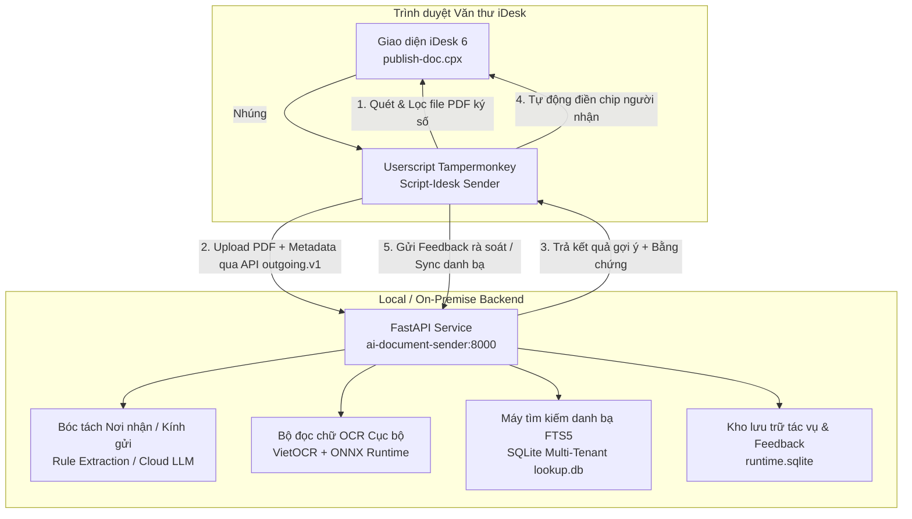
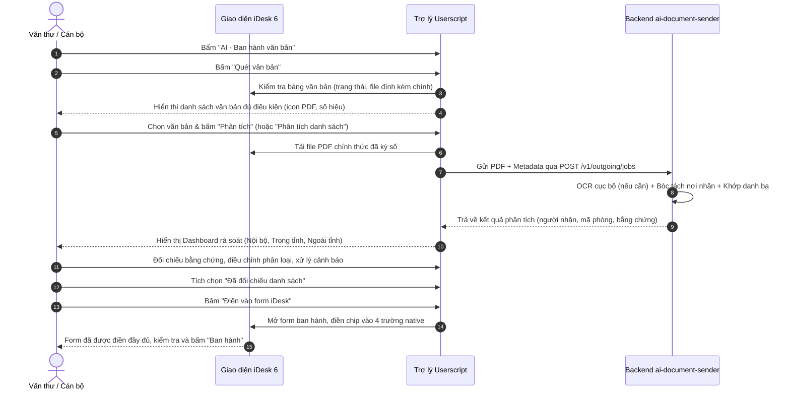

# Sổ Tay Hướng Dẫn Sử Dụng Toàn Diện Hệ Thống AI Document Sender

> **Hệ thống Trợ lý AI Ban hành văn bản iDesk (`ai-document-sender` & `Script-Idesk Sender`)**  
> Tự động phân tích nơi nhận từ tài liệu PDF chính thức (ký số, đóng dấu), đối chiếu danh bạ tổ chức/cá nhân đa đơn vị và tự động điền form ban hành trên hệ thống VNPT iDesk.

---

## Mục Lục
1. [Tổng Quan Hệ Thống](#1-tổng-quan-hệ-thống)
2. [Yêu Cầu Môi Trường & Chuẩn Bị](#2-yêu-cầu-môi-trường--chuẩn-bị)
3. [Cài Đặt & Cấu Hình Backend (`ai-document-sender`)](#3-cài-đặt--cấu-hình-backend-ai-document-sender)
4. [Cài Đặt & Cấu Hình Frontend Userscript (`Script-Idesk Sender`)](#4-cài-đặt--cấu-hình-frontend-userscript-script-idesk-sender)
5. [Quy Trình Sử Dụng Thực Tế Trên iDesk](#5-quy-trình-sử-dụng-thực-tế-trên-idesk)
6. [Các Tính Năng Nâng Cao](#6-các-tính-năng-nâng-cao)
7. [Các Lệnh CLI & Công Cụ Quản Trị](#7-các-lệnh-cli--công-cụ-quản-trị)
8. [Khắc Phục Sự Cố Thường Gặp (FAQ / Troubleshooting)](#8-khắc-phục-sự-cố-thường-gặp-faq--troubleshooting)

---

## 1. Tổng Quan Hệ Thống

Hệ thống gồm **hai thành phần độc lập nhưng gắn kết chặt chẽ**:



1. **Backend ([`ai-document-sender`](file:///c:/Workspaces/ai-document-sender)):**
   - Viết bằng **Python 3.12+ (FastAPI)**, hoạt động như một microservice độc lập.
   - Tiếp nhận file PDF văn bản và metadata qua chuẩn API `outgoing.v1`.
   - **Trích xuất thông minh**: Phân tích các mục *Nơi nhận*, *Kính gửi*, giải quyết tham chiếu sâu (*Như Điều N*, *Theo Điều N*).
   - **OCR Tiếng Việt Cục bộ (Local OCR)**: Tích hợp [VietOCR](https://github.com/pbcquoc/vietocr) và PP-OCRv4 ONNX để đọc các trang scan/ảnh trực tiếp trên máy mà không gửi ảnh ra dịch vụ đám mây bên ngoài.
   - **Định danh chính xác (Resolution Engine)**: Tra cứu danh bạ qua cơ sở dữ liệu SQLite FTS5 hỗ trợ gõ không dấu, tự động mở rộng từ viết tắt hành chính (UBND, HĐND, VP, KTTH, PVHCC...), giải quyết mã chức danh/chuyên viên (C4, C7, V4, V6...).
   - **Lưu vết và Thu thập phản hồi (Feedback Loop)**: Ghi nhận mọi quyết định của người dùng để làm dữ liệu đánh giá và tinh chỉnh.

2. **Frontend Userscript ([`Script-Idesk Sender`](file:///c:/Workspaces/Script-Idesk%20Sender)):**
   - Script chạy trực tiếp trên trình duyệt thông qua extension **Tampermonkey** / **Violentmonkey**.
   - Nhận diện các văn bản đi đủ điều kiện ban hành trên hệ thống VNPT iDesk.
   - Cung cấp giao diện bảng điều khiển AI (Dashboard) trực quan: cho phép xem tài liệu, rà soát người nhận (Nội bộ, Trong tỉnh, Ngoài tỉnh), phân loại vào 4 trường gửi (*Xử lý*, *Để biết*, *Phối hợp*, *Theo dõi*), tìm kiếm bổ sung thủ công và tự động điền vào form iDesk chỉ với 1 click.

---

## 2. Yêu Cầu Môi Trường & Chuẩn Bị

Trước khi vận hành hệ thống, cần đảm bảo máy tính đáp ứng các điều kiện sau:

| Thành phần | Yêu cầu tối thiểu | Khuyến nghị |
| :--- | :--- | :--- |
| **Hệ điều hành** | Windows 10/11 (64-bit) | Windows 11 với PowerShell 7 |
| **Python** | Python 3.12+ (đã tích hợp vào PATH) | Python 3.12 |
| **Node.js** | Node.js 18+ (để build Userscript) | Node.js 20 LTS |
| **Trình duyệt** | Google Chrome / Microsoft Edge / Cốc Cốc | Chrome hoặc Edge mới nhất |
| **Extension** | [Tampermonkey](https://www.tampermonkey.net/) | Bản mới nhất trên Chrome Web Store |
| **Phần cứng OCR** | CPU đa nhân (4 cores+) | NVIDIA GPU (hỗ trợ CUDA 12.6) nếu xử lý nhiều tài liệu scan |
| **Poppler** | Poppler for Windows (tùy chọn) | Cài đặt nếu cần render trang PDF sang ảnh cho Vision/OCR |

---

## 3. Cài Đặt & Cấu Hình Backend (`ai-document-sender`)

### Bước 3.1: Khởi tạo môi trường ảo Python

Mở PowerShell tại thư mục dự án `c:\Workspaces\ai-document-sender`:

```powershell
Set-Location C:\Workspaces\ai-document-sender

# Tạo môi trường ảo .venv
python -m venv .venv

# Nâng cấp pip và cài đặt gói cơ bản
.\.venv\Scripts\python.exe -m pip install --upgrade pip
.\.venv\Scripts\python.exe -m pip install -e ".[test]"
```

### Bước 3.2: (Tùy chọn) Cài đặt OCR tiếng Việt cục bộ (VietOCR)

Nếu cơ quan có nhiều tài liệu scan không có lớp chữ (searchable text), bạn nên cài thêm module OCR cục bộ để máy tự nhận dạng chữ mà không cần gửi dữ liệu ra bên ngoài:

```powershell
# Thiết lập UTF-8 cho console
$env:PYTHONUTF8 = '1'

# TRƯỜNG HỢP 1: Máy có Card đồ họa rời NVIDIA (hỗ trợ CUDA 12.6)
.\.venv\Scripts\python.exe -m pip install torch==2.9.1 torchvision==0.24.1 --index-url https://download.pytorch.org/whl/cu126

# TRƯỜNG HỢP 2: Máy chỉ dùng CPU (bỏ qua lệnh cài CUDA ở trên, chạy tiếp)
.\.venv\Scripts\python.exe -m pip install -e ".[ocr]"

# Tải trước file trọng số (weights) của mô hình VietOCR về máy (lưu tại var/models/)
.\.venv\Scripts\python.exe -m ai_document_sender prepare-ocr
```

### Bước 3.3: Thiết lập cấu hình tệp `.env`

Sao chép tệp mẫu sang tệp cấu hình thực tế:

```powershell
Copy-Item .env.example .env
```

Mở tệp `.env` để kiểm tra các thông số quan trọng:

```dotenv
# Cấu hình mạng máy chủ Backend
SENDER_HOST=127.0.0.1
SENDER_PORT=8000
# Khóa bảo vệ API (để trống nếu chỉ chạy nội bộ trên cùng máy 127.0.0.1)
SENDER_API_KEY=

# Đường dẫn danh bạ và chính sách alias
SENDER_LOOKUP_DB=resources/data/lookup.db
SENDER_POLICY_PATH=resources/policies/recipient_aliases.v1.json
SENDER_RUNTIME_DIR=var

# Chế độ AI Provider: 'offline' (mặc định, an toàn tuyệt đối) hoặc 'cloud'
SENDER_PROVIDER_MODE=offline

# Cấu hình OpenRouter (nếu muốn kích hoạt SENDER_PROVIDER_MODE=cloud)
OPENROUTER_API_KEY=
OPENROUTER_TEXT_MODEL=google/gemini-2.5-flash
OPENROUTER_VISION_MODEL=google/gemini-2.5-flash
OPENROUTER_URL=https://openrouter.ai/api/v1

# Cấu hình OCR Cục bộ VietOCR: 'disabled' hoặc 'vietocr'
SENDER_OCR_BACKEND=vietocr
SENDER_OCR_DEVICE=auto
SENDER_OCR_BATCH_SIZE=16
SENDER_OCR_WEIGHTS=var/models/vgg_seq2seq.pth

# Giới hạn xử lý
SENDER_MAX_FILE_BYTES=20971520
SENDER_MAX_PAGES=100
SENDER_RETENTION_DAYS=7
```

> [!TIP]
> **Chế độ hoạt động khuyến nghị:**
> - **Chế độ Offline (`SENDER_PROVIDER_MODE=offline`)**: Toàn bộ quá trình bóc tách và tra cứu diễn ra hoàn toàn nội bộ trên máy bạn. Tốc độ tức thì, không tốn chi phí token, bảo mật 100% dữ liệu văn bản nhà nước.
> - **Chế độ Cloud (`SENDER_PROVIDER_MODE=cloud`)**: Sử dụng LLM của OpenRouter kết hợp với bộ trích xuất quy tắc cục bộ. Thích hợp khi văn bản có cách diễn đạt phức tạp ngoài quy chuẩn thể thức.

### Bước 3.4: Khởi động dịch vụ Backend

Chạy lệnh sau để khởi chạy máy chủ FastAPI:

```powershell
.\.venv\Scripts\python.exe -m ai_document_sender serve
```

Khi màn hình xuất hiện thông báo:
```text
INFO:     Uvicorn running on http://127.0.0.1:8000 (Press CTRL+C to quit)
```
Dịch vụ Backend đã sẵn sàng!

### Bước 3.5: Kiểm tra trạng thái hoạt động (Health Check)
Mở trình duyệt truy cập:
- Kiểm tra tính sẵn sàng: [http://127.0.0.1:8000/health](http://127.0.0.1:8000/health)
- Tài liệu API tương tác: [http://127.0.0.1:8000/docs](http://127.0.0.1:8000/docs)

---

## 4. Cài Đặt & Cấu Hình Frontend Userscript (`Script-Idesk Sender`)

### Bước 4.1: Cài đặt tiện ích Tampermonkey
Nếu trình duyệt của bạn chưa có Tampermonkey:
1. Truy cập [Tampermonkey trên Chrome Web Store](https://chromewebstore.google.com/detail/tampermonkey/dhdgffkkebhmkfjojejmpbldmpobfkfo).
2. Nhấn **Thêm vào Chrome** (hoặc Edge).
3. Bật tùy chọn **Cho phép truy cập vào các URL của tệp** (Allow access to file URLs) trong phần Quản lý tiện ích mở rộng nếu cần.

### Bước 4.2: Build Userscript từ mã nguồn
Mở một cửa sổ PowerShell mới tại thư mục `c:\Workspaces\Script-Idesk Sender`:

```powershell
Set-Location "C:\Workspaces\Script-Idesk Sender"

# Cài đặt các thư viện đóng gói (esbuild)
npm install

# Đóng gói Userscript thành tệp duy nhất
npm run build
```

Sau khi chạy, tệp đóng gói sẽ được tạo ra tại:  
`c:\Workspaces\Script-Idesk Sender\dist\idesk_outgoing.user.js`

### Bước 4.3: Nạp script vào Tampermonkey
1. Nhấp vào biểu tượng **Tampermonkey** trên thanh công cụ trình duyệt → chọn **Tạo script mới** (Create a new script).
2. Xóa toàn bộ nội dung mẫu có sẵn trong trình soạn thảo của Tampermonkey.
3. Mở tệp [`dist/idesk_outgoing.user.js`](file:///c:/Workspaces/Script-Idesk%20Sender/dist/idesk_outgoing.user.js), sao chép toàn bộ nội dung và dán vào Tampermonkey.
4. Nhấn **Tệp (File)** → **Lưu (Save)** (hoặc phím tắt `Ctrl + S`).

### Bước 4.4: Kết nối Userscript với Backend
1. Đăng nhập vào hệ thống iDesk của đơn vị bạn.
2. Truy cập vào phân hệ **Văn bản đi → Ban hành văn bản** (hoặc bất kỳ trang quản lý văn bản đi nào).
3. Lúc này bạn sẽ thấy một nút màu xanh tím nổi bật ở góc phải màn hình mang tên: **`AI · Ban hành văn bản`**.
4. Bấm vào nút này để mở Bảng điều khiển trợ lý.
5. Bấm vào biểu tượng **Cài đặt kết nối** (biểu tượng thanh trượt/bánh răng trên thanh công cụ).
6. Nhập:
   - **Địa chỉ máy chủ**: `http://127.0.0.1:8000` (hoặc cổng bạn đã chỉ định trong `.env`).
   - **Khóa truy cập**: Để trống (hoặc nhập giá trị tương ứng với `SENDER_API_KEY` nếu bạn có đặt).
7. Nhấn **Lưu và kiểm tra**. Khi thấy thông báo màu xanh báo kết nối thành công, hệ thống đã sẵn sàng làm việc!

---

## 5. Quy Trình Sử Dụng Thực Tế Trên iDesk

Dưới đây là các bước thao tác thực tế dành cho Văn thư hoặc Cán bộ ban hành văn bản:



### Bước 1: Quét danh sách văn bản đủ điều kiện
- Trên thanh công cụ trợ lý, bấm nút **Quét văn bản**.
- Hệ thống sẽ tự động rà soát bảng văn bản trên màn hình iDesk và chỉ lọc các văn bản:
  * Mang trạng thái **Đã chuyển nội bộ** hoặc **Đã vào sổ**.
  * Có **tệp đính kèm chính hợp lệ**: Là tệp PDF đã ký số, đã đóng dấu và có tên tệp khớp với số ký hiệu văn bản.
- Cột bên trái sẽ liệt kê các văn bản đủ điều kiện kèm số ký hiệu và trích yếu.

### Bước 2: Phân tích nơi nhận bằng AI
- Bạn có thể phân tích từng văn bản bằng cách nhấn vào văn bản ở cột trái, rồi nhấn nút **Phân tích** ở khung chi tiết.
- Hoặc nhấn **Phân tích danh sách** để hệ thống tự động chạy xử lý hàng loạt theo thứ tự.
- Trạng thái xử lý sẽ hiển thị rõ ràng:
  * `Đang chờ xử lý` → `Đang đọc tài liệu` → `Đang đối chiếu danh bạ` → `Đã phân tích`.

### Bước 3: Rà soát & Tinh chỉnh kết quả (Dashboard)
Sau khi phân tích xong, giao diện hiển thị 3 vùng làm việc trực quan:

1. **Khung giữa - Nội dung rà soát:**
   - **Thông tin văn bản**: Số ký hiệu, ngày văn bản, người ký, file đính kèm.
   - **Cảnh báo cần lưu ý (`needs_review`)**:
     * Hiển thị các trường hợp viết tắt cần xác nhận (ví dụ: `VT`, danh sách chuyên viên phụ trách).
     * Tham chiếu đến các Điều trong văn bản (*Như Điều 2*, *Theo Điều 3*).
     * Bằng chứng trích lục (*evidence*): Bạn có thể đọc trực tiếp đoạn văn bản gốc mà AI đã dựa vào để tìm ra đối tượng.
   - **Mục chưa nhận diện được (`unresolved`)**: Cho phép bạn quyết định bỏ qua hoặc chỉ định người nhận tương ứng.

2. **Khung phải - Danh bạ & Phân loại người nhận:**
   - Hệ thống tự động phân chia người nhận thành 3 nhóm rõ ràng:
     * **Nội bộ cơ quan**: Lãnh đạo UBND, các Phòng/Ban chuyên môn (hiển thị rõ node cha để gửi cả phòng), các chuyên viên được giao việc.
     * **Đơn vị trong tỉnh**: Các Sở, Ban, Ngành, UBND các Huyện/Thị xã/Thành phố.
     * **Đơn vị ngoài tỉnh**: Các Bộ, cơ quan ngang Bộ, UBND các tỉnh/thành phố khác.
   - **Gán vai trò người nhận**: Đối với từng đối tượng, bạn có thể dễ dàng chuyển đổi trường tiếp nhận:
     * *Xử lý văn bản đi*
     * *Chuyển để biết*
     * *Phối hợp xử lý*
     * *Theo dõi*
   - **Tìm kiếm & Thêm thủ công**: Nếu văn bản có nơi nhận đặc thù chưa được AI bắt kịp, gõ tên vào ô tìm kiếm ở cột phải để tra cứu danh bạ tức thời và nhấn **Thêm** vào danh sách.

### Bước 4: Tự động điền vào Form ban hành iDesk
1. Khi đã đối chiếu xong, tích vào ô kiểm: **`Đã đối chiếu danh sách`**.
2. Chọn tùy chọn:
   - *Thay thế người nhận có sẵn trên form*: Xóa người nhận đang có trên form iDesk và điền toàn bộ danh sách mới từ AI.
   - *Giữ nguyên người nhận có sẵn*: Giữ lại các chip đã có trên form và bổ sung thêm người nhận mới từ AI.
3. Nhấn nút **`Điền vào form iDesk`**.
4. Userscript sẽ tự động kích hoạt form ban hành native của iDesk, mở các modal chọn người nhận và điền chính xác vào 4 ô nhập liệu tương ứng.
5. Người dùng chỉ cần liếc nhanh kiểm tra lại trên form và nhấn nút **Đồng ý / Ban hành** của chính iDesk để hoàn tất!

---

## 6. Các Tính Năng Nâng Cao

### 6.1. Đồng bộ danh bạ đa đơn vị (Smart Multi-Tenant Lookup Sync)
Mỗi cơ quan, đơn vị sử dụng iDesk có một cây danh bạ riêng. Hệ thống hỗ trợ đồng bộ danh bạ từ giao diện iDesk về backend thông qua API `/v1/sync/lookup`.

- Khi người dùng đăng nhập vào iDesk của một đơn vị cụ thể, Userscript có thể trích xuất cây danh bạ trực tiếp và đồng bộ về máy chủ.
- Cơ chế **Diff Engine thông minh**: Backend chỉ tính toán và cập nhật các bản ghi mới hoặc có thay đổi (dựa trên SHA-256 hash), không làm chậm hệ thống và không ghi đè dữ liệu lịch sử.
- Tự động sinh từ khóa tìm kiếm tiếng Việt không dấu và đánh chỉ mục toàn văn **FTS5** (Full-Text Search) siêu tốc.

### 6.2. Cơ chế giải quyết tham chiếu sâu ("Như Điều N")
Đối với các quyết định, kế hoạch hành chính, mục Nơi nhận thường ghi: *"Như Điều 3"*, *"Các cơ quan tại Điều 2"*.
- Backend sở hữu bộ giải quyết tham chiếu độc quyền ([`article_references.py`](file:///c:/Workspaces/ai-document-sender/src/ai_document_sender/article_references.py)): Tự động dò ngược văn bản đến đúng Điều N, bóc tách toàn bộ danh sách các Sở, ngành, cá nhân được giao nhiệm vụ chủ trì hoặc phối hợp, kể cả khi điều khoản trải dài qua 3-4 trang tài liệu.
- Lưu trữ đầy đủ chuỗi bằng chứng chứng minh tại sao một cá nhân hoặc đơn vị được chọn.

### 6.3. Xử lý mã chuyên viên và chức danh viết tắt
- Các mã chức danh nội bộ như `C4`, `C7` (Chuyên viên Nội chính), `V4`, `V6` (Chuyên viên Khoa giáo Văn xã)... được đối chiếu trực tiếp với danh bạ hiện hành của toàn bộ cơ quan.
- Nếu một mã trùng nhiều người, hệ thống sẽ tự động đưa vào trạng thái `needs_review` để người dùng rà soát bằng mắt, tuyệt đối không tự ý đoán mò người nhận.

### 6.4. Bảo đảm tính bất biến & Chống trùng lặp (Idempotency)
- Mỗi yêu cầu phân tích đều mang header `Idempotency-Key` được tạo từ mã văn bản, hàm băm SHA-256 của file PDF và phiên bản danh bạ.
- Tránh việc xử lý lặp lại cùng một văn bản gây tốn tài nguyên. Khi một văn bản đã được phân tích, nếu bấm lại hệ thống sẽ trả kết quả ngay trong tích tắc từ bộ nhớ đệm an toàn.

---

## 7. Các Lệnh CLI & Công Cụ Quản Trị

Thư mục backend cung cấp các công cụ dòng lệnh mạnh mẽ để phục vụ quản trị và bảo trì:

### 7.1. Khởi chạy máy chủ Backend
```powershell
.\.venv\Scripts\python.exe -m ai_document_sender serve
```

### 7.2. Tải trọng số VietOCR offline
```powershell
.\.venv\Scripts\python.exe -m ai_document_sender prepare-ocr
```

### 7.3. Nhập dữ liệu danh bạ bổ sung (Verified Overlay)
Khi có danh sách đơn vị ngoài danh bạ hoặc các nhóm đặc thù đã được kiểm chứng:
```powershell
.\.venv\Scripts\python.exe -m ai_document_sender import-overlay verified_overlay.json
```

### 7.4. Xuất dữ liệu phản hồi người dùng (Feedback Export)
Để xuất toàn bộ lịch sử các ca đã được người dùng rà soát thực tế phục vụ đánh giá hoặc huấn luyện mô hình:
```powershell
.\.venv\Scripts\python.exe -m ai_document_sender export-feedback --output var/exported_feedback.json
```

### 7.5. Chạy bộ kiểm thử tự động (Test Suite)
Kiểm tra độ toàn vẹn của mã nguồn:

```powershell
# Chạy toàn bộ unit test của backend
.\.venv\Scripts\python.exe -m pytest -q

# Chạy test của frontend Userscript
Set-Location "C:\Workspaces\Script-Idesk Sender"
npm test

# Chạy kiểm thử tích hợp End-to-End giữa Userscript và Backend
npm run verify:outgoing -- C:\Workspaces\ai-document-sender
```

---

## 8. Khắc Phục Sự Cố Thường Gặp (FAQ / Troubleshooting)

### ❓ 1. Userscript báo lỗi "Không thể kết nối đến máy chủ AI"
- **Nguyên nhân**: Dịch vụ backend chưa được bật, hoặc cổng kết nối bị sai.
- **Cách xử lý**:
  1. Kiểm tra cửa sổ console backend xem lệnh `python -m ai_document_sender serve` có đang chạy hay không.
  2. Mở trình duyệt vào thử [http://127.0.0.1:8000/health](http://127.0.0.1:8000/health). Nếu không mở được, kiểm tra cổng cấu hình trong `.env` (`SENDER_PORT`).
  3. Mở nút **Cài đặt kết nối** trên trợ lý iDesk và đảm bảo URL là `http://127.0.0.1:8000`.

### ❓ 2. Bấm "Quét văn bản" nhưng danh sách bên trái trống trơn (0 văn bản)
- **Nguyên nhân**:
  * Các văn bản trên màn hình iDesk chưa được chuyển trạng thái "Đã chuyển nội bộ" hoặc "Đã vào sổ".
  * Văn bản chưa đính kèm tệp PDF chính thức, hoặc tên tệp đính kèm không chứa số ký hiệu văn bản.
- **Cách xử lý**:
  * Đảm bảo văn bản đã có file đính kèm chính là PDF có chữ ký số hoặc dấu đỏ.
  * Tải lại trang iDesk (F5) và bấm lại **Quét văn bản**.

### ❓ 3. Tài liệu là dạng bản scan ảnh chụp, AI có đọc được không?
- **Nguyên nhân**: PDF dạng scan không có text layer, cần có OCR.
- **Cách xử lý**:
  * Trong `.env`, đặt `SENDER_OCR_BACKEND=vietocr`.
  * Chạy `python -m ai_document_sender prepare-ocr` để tải model.
  * Khởi động lại backend. Bộ đọc OCR cục bộ sẽ tự động bóc chữ tiếng Việt có dấu với độ chính xác cao.

### ❓ 4. Tại sao một số người nhận bị đánh dấu màu vàng (Cần rà soát)?
- **Giải thích**: Đây là tính năng bảo vệ an toàn của hệ thống. Khi gặp các trường hợp:
  * Viết tắt chức danh chưa chuẩn hóa trong chính sách (`VT`, `PCVP XD`...).
  * Mã chuyên viên khớp với nhiều hơn 1 người trong danh bạ.
  * Văn bản có tham chiếu phức tạp mà chưa đủ căn cứ khẳng định 100%.
- Hệ thống sẽ hiển thị nhãn cảnh báo để người dùng xác nhận bằng mắt trước khi điền vào form, đảm bảo tính pháp lý của văn bản ban hành.

### ❓ 5. Dữ liệu văn bản có bị gửi ra bên ngoài không?
- **Trả lời**: Mặc định **KHÔNG**.
- Hệ thống chạy ở chế độ `SENDER_PROVIDER_MODE=offline`. Mọi thao tác xử lý PDF, OCR bóc chữ, tra cứu danh bạ SQLite đều diễn ra 100% trong máy tính nội bộ của bạn.

---

*Tài liệu được cập nhật tự động cho hệ thống iDesk 6 và bộ đôi `ai-document-sender` / `Script-Idesk Sender`.*
